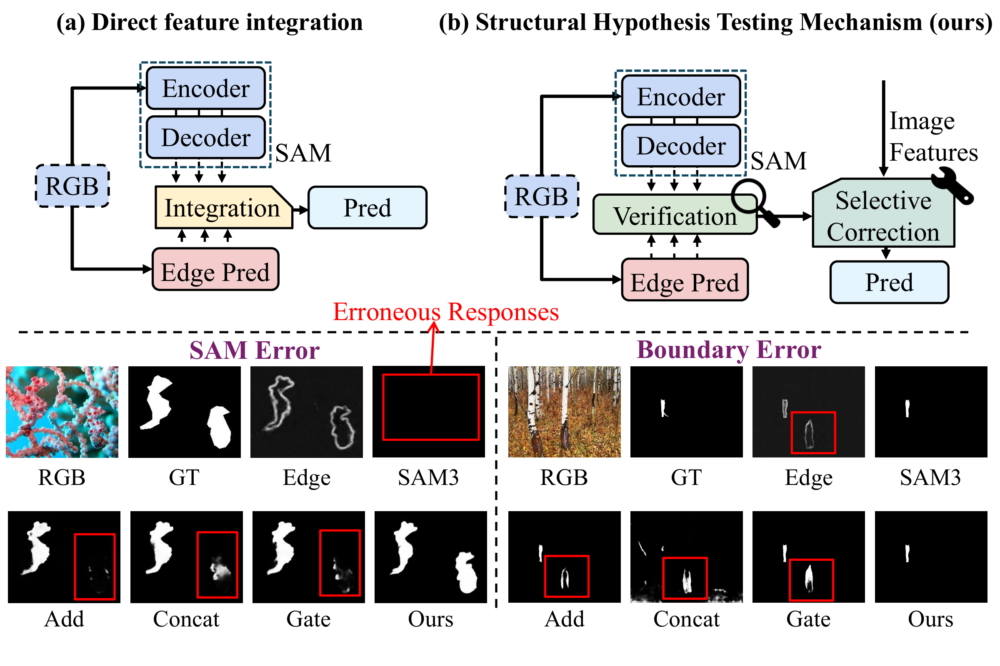
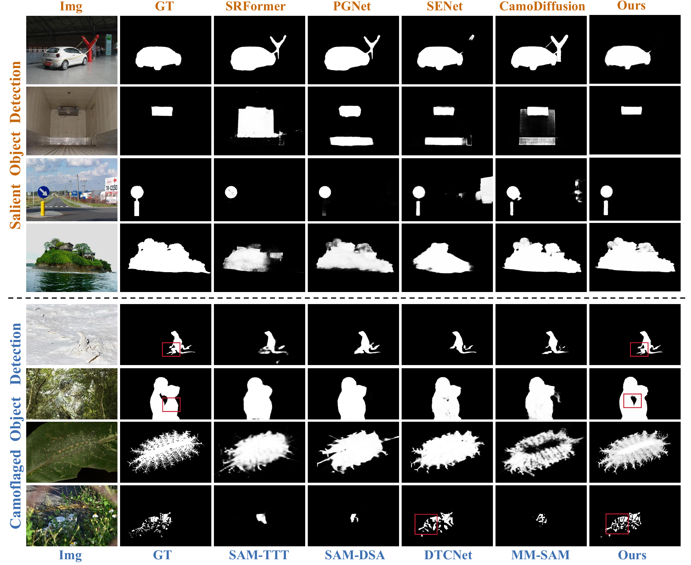

# SHTNet

**SAM3-based Hypothesis Testing Network for Salient and Camouflaged Object Detection**

SHTNet adapts SAM3 to **salient object detection (SOD)** and **camouflaged object detection (COD)** through structural verification and selective correction.

## Code Release

**Coming soon!** We are actively refining the code and will release it as soon as possible.

## Overview

SAM3 predictions and task-specific boundary cues can both contain errors. SHTNet treats the SAM3 prediction as a structural hypothesis and the boundary prediction as observational evidence. A continuous **rejection field** identifies local structural disagreements, helping the network preserve supported structures and revisit conflicting regions using image features.

## Visual Results

Representative comparisons on SOD and COD illustrate object completeness, background suppression, and fine boundary details. **Ours** denotes SHTNet; **GT** denotes ground truth.

## Benchmarks

- **SOD:** DUTS-TE, HKU-IS, ECSSD, and PASCAL-S.
- **COD:** CHAMELEON, CAMO, COD10K, and NC4K.
